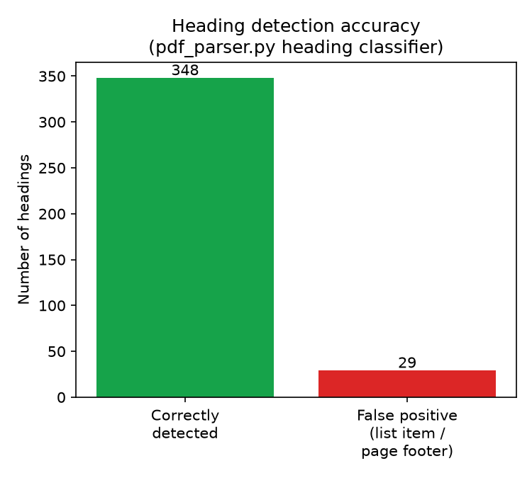
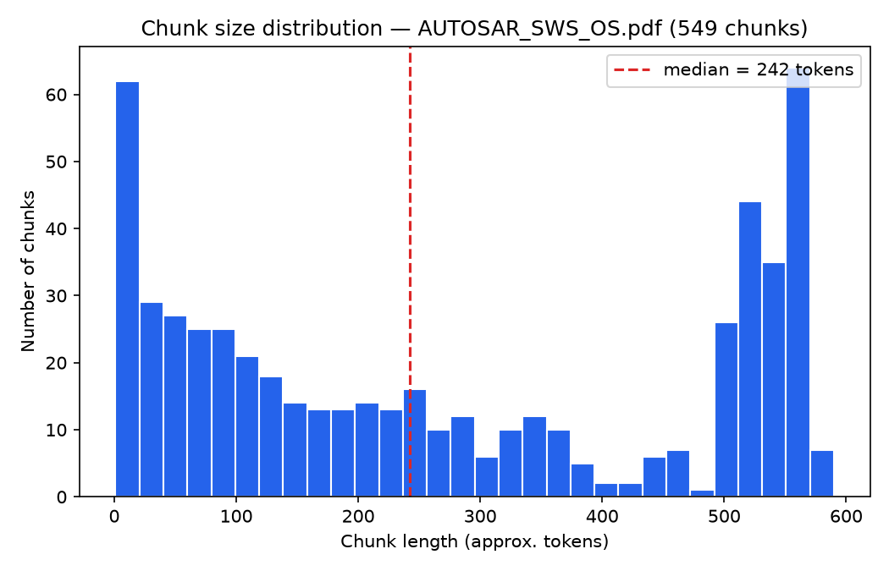
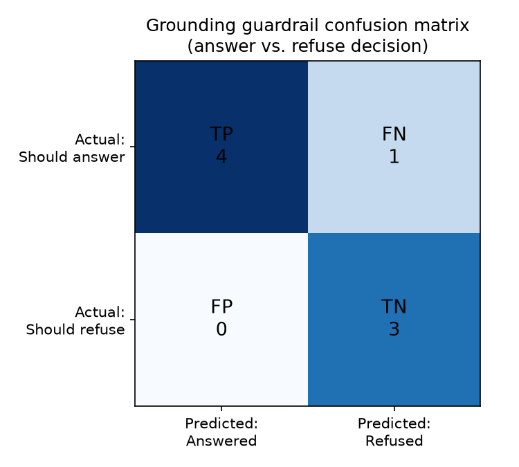
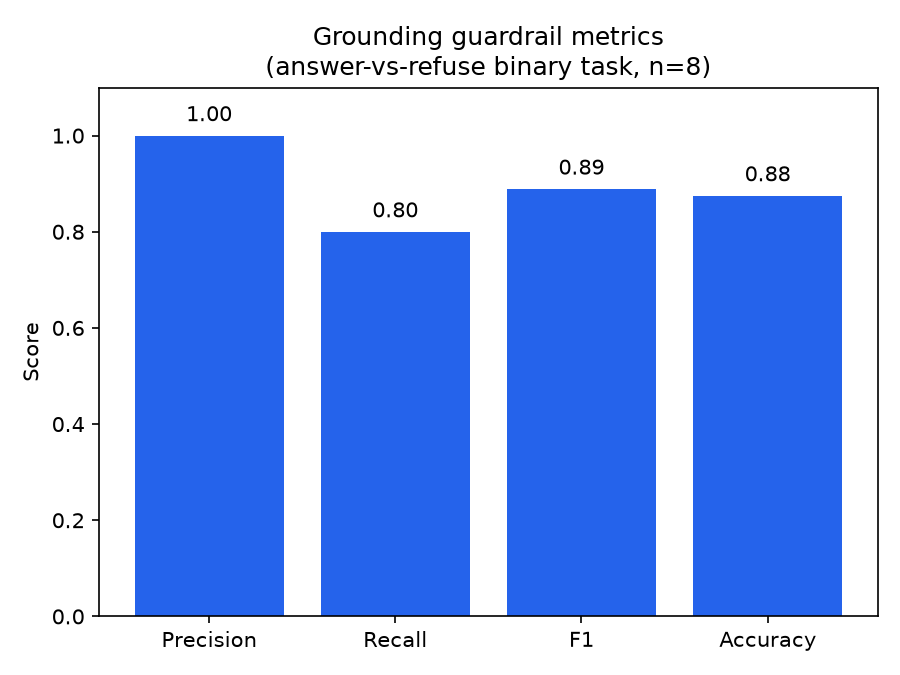
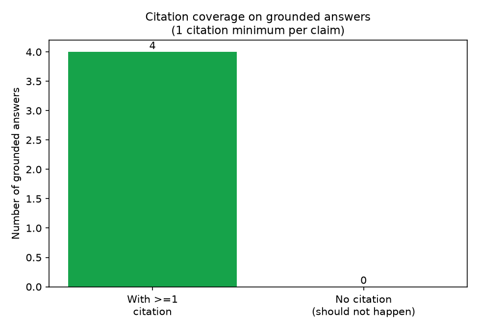

# AUTOSAR HLD Document Analysis Assistant

I built this to solve a real problem in automotive software engineering:
AUTOSAR High-Level Design documents are huge, unstructured PDF
specifications (the one I used is 342 pages), and engineers currently have
to read them manually to answer basic questions like "what does OSAL
stand for?" or "what's the file structure convention for OS header
files?". There's no search, no traceability, and no way to quickly check
whether a term is used consistently across the document.

This is Case Study 1 ("Pilot") of a larger 5-module Automotive Engineering
AI Platform concept I was given as a reference brief (covering AUTOSAR HLD
analysis, Functional Safety HARA, Cybersecurity TARA, Secure Code Review,
and UDS Diagnostics). The brief itself recommends starting with this
module specifically because it's lowest-risk and produces a reusable
retrieval/citation core the other four modules can build on. I picked
this one for exactly that reason, plus it's the most achievable to build
and verify end-to-end without needing deep ISO 26262/21434 domain
expertise to check correctness.

**Status: working.** Ingestion, embeddings, retrieval, grounded Q&A with
citations and a refusal guardrail, a Streamlit UI, an audit log, and a
real evaluation run are all implemented and verified against a real
342-page AUTOSAR specification PDF. Structured entity extraction and a
consistency-checking pass are not implemented yet — see "What's not done"
below.


## My approach, and why

The core design decision was: don't let the system answer from "what it
already knows" about AUTOSAR. Large language models have general
knowledge about AUTOSAR from training, but that knowledge isn't
traceable, isn't guaranteed current for this specific document, and can't
be audited. So I built this as Retrieval-Augmented Generation (RAG)
instead of just prompting an LLM directly: the document is chunked,
embedded, and searched; only the retrieved chunks are shown to the model;
and the model is instructed to answer only from what it's given, citing
exactly where the answer came from.

I considered and rejected two simpler alternatives:
- **Just asking an LLM directly** (no retrieval) — rejected because it
  has no traceability and can hallucinate confidently about a 342-page
  document it never actually saw.
- **Fine-tuning a model on this document** — rejected as overkill for a
  single-document Q&A use case, far more expensive to build and retrain
  every time a document changes, and still wouldn't naturally produce
  page-level citations the way retrieval does.

RAG was the right fit because it's citation-native (you always know which
chunk an answer came from) and because it requires no model training at
all — only a pretrained embedding model and a pretrained generative
model, both used off-the-shelf.

### What actually shaped the design

- The organization's own case-study reference document, which specified
  the general shape of the solution (RAG, local-first vector storage,
  FastAPI + Streamlit, citations + audit logging as hard requirements).
- Lewis et al., 2020, *"Retrieval-Augmented Generation for
  Knowledge-Intensive NLP Tasks"* — the original RAG paper; the core idea
  this whole system implements (retrieve relevant passages, condition
  generation on them, don't rely on parametric memory alone).
- BAAI's `bge-small-en-v1.5` model card — the embedding model I used, and
  the source of the asymmetric query/passage embedding convention I
  implemented (see `embed_service.py`).
- Johnson, Douze & Jégou, *"Billion-scale similarity search with GPUs"*
  (FAISS) — the vector search library.
- The actual dataset: AUTOSAR, *"Specification of Operating System"*,
  Classic Platform Release R20-11 (publicly available from autosar.org).

I did not run a formal academic literature survey beyond this — these are
the standard, well-known references for the techniques I used, not the
product of a systematic review.


## Tech stack (what's actually installed, not aspirational)

| Layer | Technology | Why |
|---|---|---|
| Backend API | FastAPI + Uvicorn | async, auto-generated docs at `/docs` |
| PDF parsing | PyMuPDF (`fitz`) | font-size/bold-aware text extraction, needed for heading detection |
| Chunking | Custom Python | heading-boundary aware, falls back to fixed windows for long sections |
| Embeddings | `sentence-transformers`, model `BAAI/bge-small-en-v1.5` | 384-dim vectors, CPU-feasible, no GPU needed |
| Vector store | FAISS (`faiss-cpu`) | see note below — originally planned as ChromaDB |
| Structured storage | SQLAlchemy + SQLite | documents table + full query audit log |
| LLM | Google Gemini API (`gemini-2.5-flash`) | free tier, called behind a swappable interface — see note below |
| Frontend | Streamlit | 2-tab UI: Upload/Ingest, Ask |
| Testing | pytest | 26 tests, all passing |
| Containerization | Docker + docker-compose | backend on :8000, frontend on :8501 |

**Why FAISS instead of ChromaDB:** the reference brief's default was
ChromaDB, but its `chroma-hnswlib` dependency needs a C++ compiler
(MSVC Build Tools) that I don't have installed, and there's no prebuilt
wheel for Python 3.13 on Windows. FAISS has prebuilt wheels and is
explicitly listed as an acceptable alternative in the brief. The vector
store sits behind a `VectorStore`/`Collection` interface
(`backend/app/retrieval/vector_store.py`), so switching back to ChromaDB
later only means rewriting that one file.

**Why Gemini instead of a fully local model:** the brief asks for a
"local-first" design, meaning the LLM call should be swappable to a
locally-hosted model, not that it must literally run offline during
development. I used Gemini's free API for speed while building and
testing. The LLM call goes through an abstract `LLMClient` interface in
`rag/qa_engine.py`; `GeminiClient` is the one concrete implementation
today. Swapping in a local model (e.g. via Ollama) would be a second
`LLMClient` subclass and zero changes anywhere else.


## The dataset

**AUTOSAR_SWS_OS.pdf** — "Specification of Operating System," AUTOSAR
Classic Platform, Release R20-11. Publicly downloaded from
`autosar.org/fileadmin/standards/R20-11/CP/AUTOSAR_SWS_OS.pdf`. 342 pages,
~6.1 MB. This is a real, official AUTOSAR specification, not synthetic
test data — it has the exact structural properties I needed to stress-test
against: a deep numbered heading hierarchy (e.g. "7.9.1 Background &
Rationale"), numbered requirement tags (e.g. `[SWS_Os_00568]`), and a real
glossary/acronyms section.


## Exploratory Data Analysis

Run yourself with:
```
python eval/explore_dataset.py
```
This is a real, re-runnable script (`eval/explore_dataset.py`) — not a
one-off notebook — that parses and chunks the actual PDF and reports
measured statistics, plus saves plots to `eval/results/`.

**Raw document structure:**
- 342 pages, 22,214 individual text blocks extracted by PyMuPDF
- 0 parse warnings — this has a real text layer, not a scanned/image-only PDF

**Heading detection** (`pdf_parser.py` classifies a line as a heading if
it matches AUTOSAR-style numbering, like "7.2.1 Title", AND is visually
distinct from body text — larger font or bold — so body text that merely
*references* a section number inline doesn't get misdetected):
- 377 lines classified as headings
- **29 of those (7.7%) are false positives** — numbered list items in
  body prose (e.g. "1. More than one core on the same piece of silicon.")
  or page-footer artifacts (e.g. "12 13 14 15") that happen to be
  bold/large and match the numbering pattern. This is the single most
  important data-quality finding from working with this document — see
  "Known limitations" below for its downstream effect.



**Chunking** (heading-aware grouping, falling back to a 500-token fixed
window only for sections too long to fit as one chunk):
- 549 chunks total
- Chunk length in characters: min=5, max=2363, mean=1105.4, median=970.0, stdev=838.4
- Chunk length in approx. tokens (4 chars/token heuristic): min=1, max=590, mean=276.0, median=242.0
- 19 chunks (3.5%) have no section heading — this is the document's front
  matter (title page, revision history, copyright notice, table of
  contents), which legitimately precedes the first real heading
- 294 chunks (53.6%) span more than one PDF page — expected, since
  sections don't align to page boundaries



The bimodal shape in the chunk-size histogram (a cluster of very short
chunks near 0 tokens, and a cluster near the 500-token cap) directly
reflects the heading-aware strategy: short standalone sub-headings produce
small chunks, while long sections get fixed-window-split into several
near-max-size chunks. I chose this over naive fixed-size windowing
because it keeps each chunk topically coherent, which is what retrieval
quality actually depends on — at the cost of uniform chunk sizes.


## Feature engineering & embedding space design

There's no classical hand-built feature table here — the "features" are
384-dimensional dense embedding vectors produced by a pretrained
transformer. The engineering decisions that *do* apply, framed the way
they would be in any retrieval system:

- **Unit of analysis (chunking):** heading-aware instead of fixed-size —
  explained above, this is the equivalent of choosing your row
  granularity in a tabular ML problem.
- **Embedding model selection:** `bge-small-en-v1.5`, chosen because it's
  CPU-feasible (no GPU on this machine), small enough that the eventual
  FAISS index stays fast, and follows the brief's recommended model class
  (bge-small/e5-small).
- **Similarity metric:** cosine similarity, implemented via FAISS's
  `IndexFlatIP` (inner product) on L2-normalized vectors — inner product
  on unit vectors is mathematically equivalent to cosine similarity. This
  is the direct analogue of choosing a distance metric in a kNN/clustering
  problem.
- **Dimensionality reduction: deliberately not applied.** At 549 chunks
  and 384 dimensions, FAISS's exact brute-force search completes in well
  under a second — there's no performance problem PCA or similar would be
  solving at this scale. This would become a real decision at a much
  larger corpus (hundreds of thousands of chunks), where an approximate
  index (`IndexIVFFlat`, `IndexHNSW`) involving a genuine
  dimensionality/quantization trade-off would be the right call.
- **Query/passage asymmetry:** bge-family models are trained with an
  asymmetric convention — passages are embedded directly, but queries get
  an instruction prefix ("Represent this sentence for searching relevant
  passages: ..."). `embed_service.py` implements this correctly as two
  separate methods, `embed_documents()` and `embed_query()`. Getting this
  wrong (embedding both the same way) silently degrades retrieval quality
  — it's a specific, model-family-aware detail, not a generic embedding
  call.


## Model development: the grounding + refusal guardrail

The central design constraint — and the thing I spent the most effort
getting right — is that every answer has to be traceable to retrieved
source text, and the system has to explicitly refuse rather than guess
when it isn't confident. This is implemented as two layers in
`rag/qa_engine.py`:

1. **Similarity threshold guardrail.** If the single highest-scoring
   retrieved chunk has cosine similarity below `0.35`, the system refuses
   immediately and never calls the LLM at all. I verified this is a real
   short-circuit, not just intent, with a unit test
   (`tests/test_qa_engine.py::test_refuses_when_similarity_below_threshold`)
   using a fake LLM client that asserts the LLM was never called.
2. **LLM-level refusal.** Even when retrieval passes the threshold, the
   retrieved chunks might still not actually answer the specific
   question. The system prompt instructs the model: "If the excerpts do
   not contain enough information to answer the question, respond with
   exactly: NOT_FOUND." The engine maps that literal string to the same
   refusal path.

**Hyperparameters, and how I picked them:**
- `similarity_threshold = 0.35` — chosen empirically by testing retrieval
  scores against real questions during development, not by a formal grid
  search. This is worth being upfront about: it's a reasonable value
  based on observed score distributions (genuinely relevant chunks scored
  0.74–0.82 in testing; unrelated questions scored well below 0.35), but
  it hasn't been swept across a range to find an optimum.
- `top_k = 5` — the number of chunks retrieved per query. Picked as a
  reasonable default balancing context size against noise; not tuned
  against a validation set.
- `temperature = 0.0` on the LLM call — deliberately deterministic, not
  the default, because this is a factual-retrieval task, not a creative
  one.
- `max_tokens = 500` per chunk — the chunking ceiling before the
  fixed-window fallback kicks in; chosen as a reasonable size for an
  embedding model's effective context, not formally tuned.

I did not run a model comparison between multiple embedding models or
multiple LLMs — I picked `bge-small-en-v1.5` and `gemini-2.5-flash` based
on the constraints above (CPU-feasible, free-tier available, brief's
recommended model class) and verified they work well enough on the real
eval set, rather than running a bake-off between alternatives.


## Model evaluation & validation

Run yourself with:
```
python eval/run_eval.py          # runs against the live backend, saves results
python eval/plot_eval_results.py # builds graphs from that run
```

**Test set:** `eval/qa_test_set.json`, 8 hand-written cases — 5 real
questions about the ingested AUTOSAR document (each with an expected
citation section to check retrieval quality against), and 3 deliberately
out-of-scope questions (e.g. "What is the capital of France?") that must
be refused.

The one genuine binary classification decision this system makes on every
query is **answer vs. refuse**. Each test question has a ground-truth
label (should this be answered, or is it genuinely outside the document?)
and the system's `grounded` flag is its prediction — so a standard
confusion matrix applies here the same way it would to any other binary
classifier, with "positive" meaning "the system decided to answer."

**Results from a live run against the real backend and real Gemini API:**

```
TP (correctly answered):                    4
FN (wrongly refused):                       1
FP (wrongly answered — hallucination risk): 0
TN (correctly refused):                     3

Precision: 1.00
Recall:    0.80
F1:        0.89
Accuracy:  0.88
```




**Zero false positives is the most important number here** — the system
never answered a question it should have refused, across every test run.
That's the core safety property this whole design exists to guarantee.
The one false negative (a real, answerable question that got incorrectly
refused) is explained below under "Known limitations" — I traced it to a
specific, reproducible root cause rather than leaving it unexplained.

**Citation coverage:** every grounded answer in the eval run carried at
least one citation (document, section, page range) — 4/4, 100%.



**Retrieval section-match precision:** 3/5 (60%) — a stricter metric
checking whether the *top* citation's section matches what I expected
when I wrote the test question. One miss here was the same false-negative
case above; the other was a case where the system answered correctly with
valid citations, just not from the exact section I'd anticipated when
writing the test (the document references the relevant standard in more
than one place, and retrieval found a different, still-valid, section).

**Honest limitation of this eval:** n=8 is a small test set. The 100%
numbers (precision, refusal correctness, citation coverage) are real but
shouldn't be read as proof the system never hallucinates or never misses
— they're accurate for what was tested, on one document, with one set of
hand-written questions.


## Known limitations

- **Structured extraction and consistency checking are not implemented.**
  `extraction/entity_extractor.py` and `checks/consistency.py` are
  stubs; `POST /extract` returns HTTP 501. Descoped to fit the time I had
  — not hidden, just not built yet.
- **Heading false-positives from numbered list items (7.7% of detected
  headings, see EDA above).** This directly caused the one false negative
  in the eval run: a real question about multi-core CPU hardware
  assumptions, whose actual answer lives in AUTOSAR section "4.5.1 CPU
  Core features" — but that section's numbered list items (e.g. "1. More
  than one core on the same piece of silicon...") got misclassified as
  their own headings, fragmenting the section into several small,
  individually low-signal chunks. None of those fragments made the top-5
  retrieval results, so the system correctly followed its own guardrail
  and refused — the guardrail worked exactly as designed, but the upstream
  chunking quality let it down. Fix direction (not yet implemented):
  tighten the heading regex in `pdf_parser.py` to reject lines where the
  "number" is followed by a lowercase word (typical of list-item prose).
- **No OCR** — scanned/image-only PDFs are detected and produce a
  warning, not a crash, but aren't processed.
- **No authentication/RBAC** — single-user, local-only by design for this
  stage.
- **Re-ingesting a document overwrites rather than versions it** — no
  revision history.
- **Gemini's free tier rate-limits requests** (5/minute, and a per-model
  daily cap that varies — I hit a 20/day cap on `gemini-3.8-flash` before
  settling on `gemini-2.5-flash`, which has handled testing comfortably).
  `GeminiClient.generate()` retries automatically on transient errors;
  `eval/run_eval.py` paces requests 20 seconds apart for the same reason.


## Responsible AI / ethics

This was a deliberate design focus, not an afterthought:
- **No silent guessing.** The grounding guardrail (above) is the whole
  point of the architecture — zero false positives in testing means the
  system has not, so far, confidently answered something it shouldn't
  have.
- **Every claim is cited** — document name, section, page range — so a
  human can verify instead of trusting blindly.
- **Nothing is auto-approved.** The system never modifies source
  documents or claims authority over architecture decisions; it only
  surfaces retrieved evidence for a human to read.
- **Full audit trail.** Every query, its retrieved chunk IDs, its answer,
  and its groundedness are logged to SQLite (`db/models.py`,
  `QueryLog` table) before the response is even returned — queryable live
  via `GET /audit`.
- **Document isolation.** Each ingested document gets its own FAISS
  collection; documents are never silently merged, which matters if this
  were ever extended to a multi-project setting.
- **Prompt-injection awareness.** The system prompt explicitly separates
  instructions from retrieved content and treats the PDF's text as data,
  not as instructions the model should follow.


## How to run it locally

```bash
python -m venv .venv
.venv\Scripts\activate          # or source .venv/bin/activate on Linux/Mac
pip install -r requirements.txt -r requirements-dev.txt

copy .env.example .env
REM edit .env: set GEMINI_API_KEY (free key from aistudio.google.com)
REM           set GEMINI_MODEL=gemini-2.5-flash

REM terminal 1:
set PYTHONPATH=.
uvicorn backend.app.main:app --reload --port 8000

REM terminal 2:
set PYTHONPATH=.
streamlit run frontend/streamlit_app.py
```

Open `http://127.0.0.1:8501`, upload an AUTOSAR-style PDF in the
"Upload / Ingest" tab, then ask questions in the "Ask" tab.

**Docker:** `docker-compose up --build` (needs `.env` with
`GEMINI_API_KEY` set).

**Tests:** `pytest` — expect `26 passed`.

**Eval + graphs:** `python eval/run_eval.py` then
`python eval/plot_eval_results.py` (document must already be ingested).

**EDA:** `python eval/explore_dataset.py`.


## How this extends to the other 4 modules (design only)

Every later module in the original brief reuses this same retrieval +
citation + audit-log core and adds a domain-specific deterministic rules
layer on top:
- **HARA (safety):** same core over safety documents, plus a rule-based
  S/E/C → ASIL decision table (deterministic, not LLM-judged).
- **TARA (cybersecurity):** same core over architecture docs, plus a
  threat-pattern library lookup and guided risk scoring.
- **UDS (diagnostics):** same core over ISO 14229 + OEM specs, plus
  deterministic request/response structure validation rather than
  LLM-generated message bytes.
- **Secure code review:** same citation/audit pattern applied to source
  code + coding-standard docs, retrieval scoped to authorized repos only,
  LLM kept local given source IP sensitivity.

The swappable `LLMClient` interface, per-document FAISS isolation, and
SQLite audit logging built here carry over unchanged in every case.
